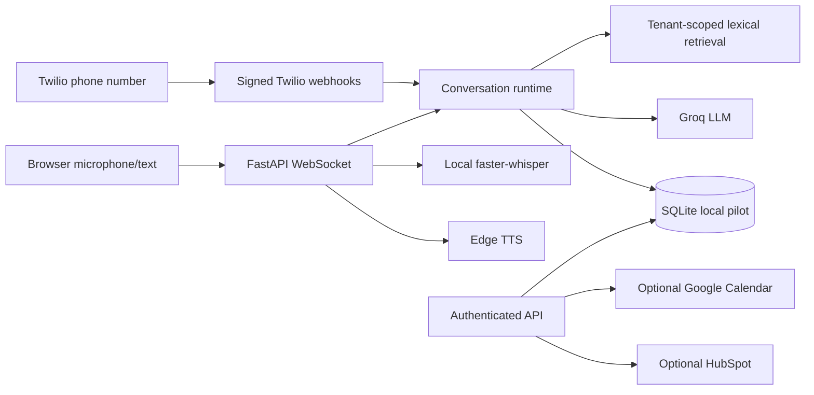

# Vocalis

Repository: [AnvitDevadiga/vocalis](https://github.com/AnvitDevadiga/vocalis). Portfolio page: [anvitdevadiga.github.io/vocalis](https://anvitdevadiga.github.io/vocalis/). The portfolio page is static; the voice backend is not hosted there.

Vocalis is an **early multi-tenant voice-agent pilot**, evolved from a single-clinic prototype. It includes a browser microphone demo, Twilio inbound speech-turn integration, tenant-scoped call records, a small knowledge retriever, local appointment and lead tools, optional Google Calendar and HubSpot adapters, escalation records, and measured per-turn server timing. It is **not yet a production-ready real-time phone platform**; see [current state](docs/CURRENT_STATE.md) and [implementation plan](docs/IMPLEMENTATION_PLAN.md).



## Capabilities and demo

The served browser demo is at `/` after local setup. No hosted live URL or screenshot is available. Supported actions today: tenant-scoped text knowledge upload/retrieval, browser conversation, inbound Twilio speech turns, local appointment booking/cancellation, local lead upsert, optional Google Calendar booking, optional HubSpot contact upsert, and human escalation records. Voice booking asks the caller to confirm the exact draft before creating an appointment.

## Local setup

Requires Python 3.12+ and a Groq API key for generated responses. Audio transcription requires the `faster-whisper` model download on first use. TTS uses Edge TTS. Text conversation works without microphone dependencies, but without a Groq key it returns an explicit outage response.

```bash
python3 -m venv .venv
source .venv/bin/activate
pip install -r requirements.txt
cp .env.example .env
# Fill GROQ_API_KEY in .env, then export the environment (or use a process manager).
set -a; source .env; set +a
python -m vocalis.admin 'Example Business'
uvicorn app:app --host 127.0.0.1 --port 8000
```

The bootstrap prints a tenant ID and API key once. Store them securely. Set `VOCALIS_PUBLIC_DEMO=1` and `VOCALIS_DEMO_TENANT_ID=<tenant ID>` to permit the public browser demo. The demo limits connections and turns per IP; deploy behind a reverse proxy with additional rate controls. Open `http://localhost:8000` and allow microphone access. Hold the button to record; release to send. The server sends a cancellation message when a new turn interrupts playback. Browser audio is whole-turn PCM, and TTS playback starts after synthesis completes.

To add business knowledge:

```bash
curl -X POST http://localhost:8000/api/knowledge -H 'x-api-key: YOUR_KEY' -H 'content-type: application/json' -d '{"title":"Hours","content":"We open Monday to Friday, 9 AM to 5 PM."}'
```

Authenticated endpoints include `/api/calls`, `/api/calls/{id}`, `/api/analytics`, `/api/knowledge`, `/api/appointments`, and `/api/leads`. OpenAPI docs are at `/docs`. Knowledge upload currently accepts text, not PDF. The browser demo is chat only; there is no admin dashboard yet. `static/index.html` and `legacy_app.py` retain the original prototype for reference and are not served by the new app.

## GitHub Pages portfolio

The static, resume-ready page lives in `site/index.html`. `.github/workflows/deploy-pages.yml` publishes that directory when `main` changes. In the repository settings, set Pages **Build and deployment → Source** to **GitHub Actions**. GitHub Pages cannot run FastAPI or WebSockets; the page labels the live voice demo as unavailable until a backend is hosted separately.

## Docker

```bash
docker compose up --build
```

The Compose file runs a single API instance with a persistent SQLite volume. Set secrets in `.env` first. It is for local evaluation, not a horizontally scaled production deployment. A public HTTPS proxy with WebSocket support is needed for remote browser microphone use.

## Phone setup

Set `TWILIO_AUTH_TOKEN` and `VOCALIS_PUBLIC_BASE_URL` (the exact externally visible HTTPS origin). Bootstrap a tenant with `--phone-number +15551234567` and optionally `--transfer-number +15557654321`. Configure that Twilio number's **incoming voice webhook** as `POST https://your-domain/twilio/voice`. Twilio sends speech results to the signed `/twilio/gather` action. Signatures are checked before processing; repeated gather turns return the same response. This is a real phone integration when credentials, number, and public endpoint exist, but it is turn-based Twilio speech input and Twilio `<Say>` output, not bidirectional audio streaming. See [integrations](docs/INTEGRATIONS.md).

## Evaluation and measured results

```bash
pytest -q
```

At implementation time, **14 deterministic tests passed in the final local run** on the local host. This is test-suite runtime, not voice response latency. Live latency percentiles are populated only from completed turns in `/api/analytics`; there is no published production latency result or evaluation score. See [evaluation](docs/EVALUATION.md).

## Key limits

The API is a single-process SQLite pilot. There is no vector index, PDF parser, Next.js dashboard, model-judge evaluation, recording retention system, OAuth refresh, outbound calling, or streaming telephony audio. Google Calendar and HubSpot adapters need tenant-specific configuration and live validation. Production operation needs PostgreSQL, durable distributed idempotency, credential management, observability export, load tests, and privacy/consent review. See [deployment](docs/DEPLOYMENT.md) and [security](docs/SECURITY.md).
