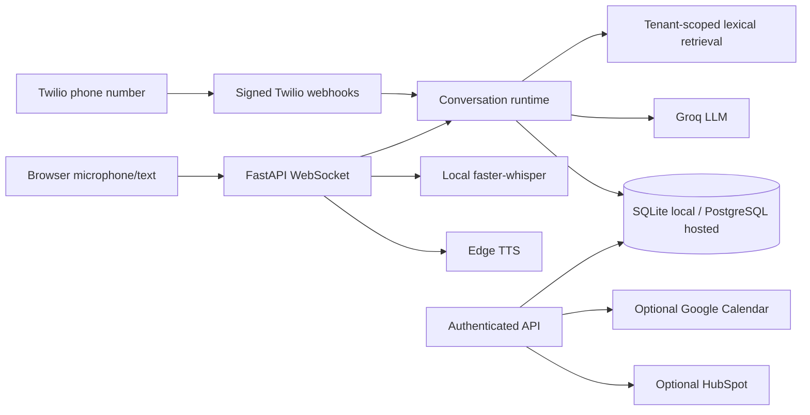

# Vocalis

Repository: [AnvitDevadiga/vocalis](https://github.com/AnvitDevadiga/vocalis). Portfolio page: [anvitdevadiga.github.io/vocalis](https://anvitdevadiga.github.io/vocalis/). The portfolio page is static; the voice backend is not hosted there.

Vocalis is an **early multi-tenant voice-agent pilot**, evolved from a single-clinic prototype. It includes a browser microphone demo, Twilio inbound speech-turn integration, tenant-scoped call records, a small knowledge retriever, local appointment and lead tools, optional Google Calendar and HubSpot adapters, escalation records, and measured per-turn server timing. It is **not yet a production-ready real-time phone platform**; see [current state](docs/CURRENT_STATE.md) and [implementation plan](docs/IMPLEMENTATION_PLAN.md).



## Capabilities and demo

The public portfolio page is [anvitdevadiga.github.io/vocalis](https://anvitdevadiga.github.io/vocalis/). It is a static showcase; no live voice API or hosted browser-call demo is available. The browser demo runs only after local setup. Supported actions today: tenant-scoped text knowledge upload/retrieval, browser conversation, inbound Twilio speech turns, local appointment booking/cancellation/rescheduling, local lead upsert, optional Google Calendar availability, booking, cancellation, and rescheduling, optional HubSpot contact upsert, and human escalation records. Voice booking asks the caller to confirm the exact draft before creating an appointment.

## Local setup

Requires Python 3.12+ and a Groq API key for generated responses. Audio transcription uses local `faster-whisper` by default or Groq Whisper when `VOCALIS_STT_PROVIDER=groq`; the hosted preview uses Groq to avoid local model memory usage. TTS uses Edge TTS. Text conversation works without microphone dependencies, but without a Groq key it returns an explicit outage response.

```bash
python3 -m venv .venv
source .venv/bin/activate
pip install -r requirements.txt
cp .env.example .env
# Fill GROQ_API_KEY in .env, then export the environment (or use a process manager).
set -a; source .env; set +a
python -m vocalis.admin 'Example Business'
python -m vocalis.start
```

SQLite is the default. For PostgreSQL, set `VOCALIS_DATABASE_URL` in the environment before creating a tenant; run `python -m alembic upgrade head` first, or use the Docker startup module, which applies migrations automatically.

The bootstrap prints a tenant ID and API key once. Store them securely. Set `VOCALIS_PUBLIC_DEMO=1` and `VOCALIS_DEMO_TENANT_ID=<tenant ID>` to permit the public browser demo. The demo limits connections and turns per IP; deploy behind a reverse proxy with additional rate controls. Open `http://localhost:8000` and allow microphone access. The browser demo asks for explicit privacy consent before creating a call record. Hold the button to record; release to send. Audio is capped at 30 seconds; WebSocket audio remains whole-turn PCM and TTS playback starts after synthesis completes.

To add business knowledge:

```bash
curl -X POST http://localhost:8000/api/knowledge -H 'x-api-key: YOUR_KEY' -H 'content-type: application/json' -d '{"title":"Hours","content":"We open Monday to Friday, 9 AM to 5 PM."}'
```

Authenticated endpoints include `/api/calls`, `/api/calls/{id}`, `/api/analytics`, `/api/knowledge`, `/api/appointments`, and `/api/leads`. OpenAPI docs are at `/docs`. Knowledge upload currently accepts text, not PDF. The browser demo is chat only; there is no admin dashboard yet. `static/index.html` and `legacy_app.py` retain the original prototype for reference and are not served by the new app.

## GitHub Pages portfolio

The static, resume-ready page lives in `site/index.html`. `.github/workflows/deploy-pages.yml` publishes that directory when `main` changes. In the repository settings, set Pages **Build and deployment → Source** to **GitHub Actions**. GitHub Pages cannot run FastAPI or WebSockets; the page labels the live voice demo as unavailable until a backend is hosted separately.

## Docker

```bash
VOCALIS_ENV_FILE=.env docker compose up --build
```

The default Compose profile runs one API instance with a persistent SQLite volume. Set secrets in `.env` first. To use PostgreSQL, set `VOCALIS_DATABASE_URL` to a reachable PostgreSQL DSN; startup applies Alembic migrations. SQLite mode is for local evaluation and one API replica. A public HTTPS proxy with WebSocket support is needed for remote browser microphone use.

`render.yaml` is a free-tier preview Blueprint for the API. It requires a PostgreSQL `VOCALIS_DATABASE_URL` and a `GROQ_API_KEY`; when both are configured, startup creates the restricted public-demo tenant. Free web instances sleep and have ephemeral filesystems, so this is suitable for portfolio preview traffic, not production availability. See the [deployment guide](docs/DEPLOYMENT.md) for the GitHub Pages connection steps.

For an existing SQLite database, stop the API and CRM worker, set `VOCALIS_DATABASE_URL` to an empty migrated PostgreSQL database, then run `python -m vocalis.migrate_sqlite --source data/vocalis.db --backup data/vocalis.pre-postgres.sqlite`. The command creates a protected online backup, reads SQLite without modifying it, and refuses a non-empty PostgreSQL target. See the [migration runbook](docs/DEPLOYMENT.md).

## Phone setup

Set `TWILIO_AUTH_TOKEN` and `VOCALIS_PUBLIC_BASE_URL` (the exact externally visible HTTPS origin). Bootstrap a tenant with `--phone-number +15551234567` and optionally `--transfer-number +15557654321`. Configure that Twilio number's **incoming voice webhook** as `POST https://your-domain/twilio/voice`. Twilio sends speech results to the signed `/twilio/gather` action. Signatures are checked before processing; repeated gather turns return the same response. This is a real phone integration when credentials, number, and public endpoint exist, but it is turn-based Twilio speech input and Twilio `<Say>` output, not bidirectional audio streaming. See [integrations](docs/INTEGRATIONS.md).

## Evaluation and measured results

```bash
python3 -m pytest -q
python3 -m vocalis.evaluate
```

The last fully provisioned local run passed **49 deterministic tests**, including disposable PostgreSQL migration and SQLite transfer runs. The current checkout passes **54 tests**, with the PostgreSQL integration module skipped because `psycopg` is unavailable in this environment, plus **7 of 7 offline evaluation scenarios**. These are local checks, not live voice quality or latency scores. Live latency percentiles are populated only from completed turns in `/api/analytics`; there is no published production latency result or evaluation score. See [evaluation](docs/EVALUATION.md) and the [phased roadmap](docs/ROADMAP.md).

## Key limits

The default local deployment is a single-process SQLite pilot; PostgreSQL storage and Alembic migrations are available for hosted deployment when `VOCALIS_DATABASE_URL` is configured. Lead capture is committed locally with an optional HubSpot sync job; jobs have leased worker processing, retry backoff, and a tenant-authenticated retry endpoint. Run the optional worker with `python -m vocalis.crm_worker` or Compose profile `crm-worker`. Call records and their events/state are automatically pruned after the configured retention period (default 30 days); appointment, lead, and knowledge lifecycles still require separate policies. Private SQLite and PostgreSQL backup tooling is available through `python -m vocalis.backup --output <new-file>`. There is no vector index, PDF parser, Next.js dashboard, model-judge evaluation, OAuth refresh, outbound calling, or streaming telephony audio. Google Calendar and HubSpot adapters need tenant-specific configuration and live validation. Production operation still needs credential management, observability export, load tests, backup restore drills, and privacy review. See [deployment](docs/DEPLOYMENT.md) and [security](docs/SECURITY.md).
