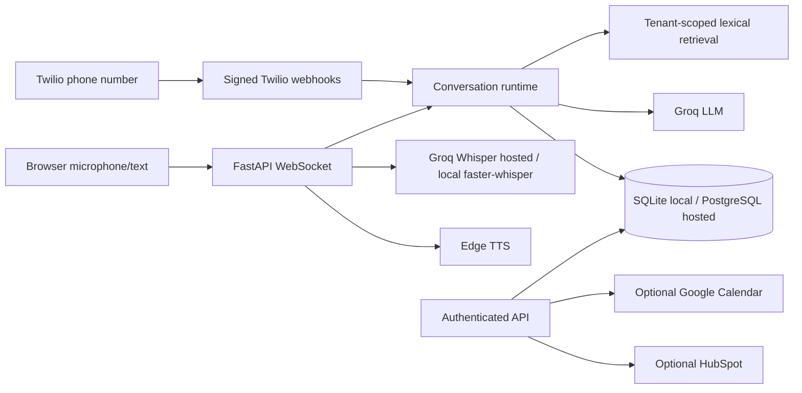

# Vocalis

Repository: [AnvitDevadiga/vocalis](https://github.com/AnvitDevadiga/vocalis). Portfolio page: [anvitdevadiga.github.io/vocalis](https://anvitdevadiga.github.io/vocalis/). Live browser demo and API: [vocalis-api-z6sd.onrender.com](https://vocalis-api-z6sd.onrender.com/). The portfolio page is static and connects to the separately hosted backend.

Vocalis is Anvit Tewarika's personal voice assistant for arranging meetings. Visitors can speak or type, have Vocalis check calendar availability, review a proposed time, and confirm a booking. The current experience uses Groq for speech transcription and language generation, Edge TTS for spoken responses, and a FastAPI backend. See the [current state](docs/CURRENT_STATE.md) and [phased roadmap](docs/ROADMAP.md) for implemented behavior and remaining work.



## Capabilities and demo

The public portfolio page is hosted on GitHub Pages; the browser demo and API are hosted separately on Render. The demo uses Neon Postgres and Groq free tiers; the first request after inactivity may be slow. The public demo requires Google Calendar credentials before it can confirm a booking and fails closed while Calendar is not ready. When configured, it checks `GOOGLE_CALENDAR_BUSY_IDS` for conflicts, writes only to `GOOGLE_CALENDAR_ID`, and attaches 24-hour and 2-hour popup reminders. Do not add API keys to the repository or paste them into chat.

## Local setup

Requires Python 3.12+ and a Groq API key for generated responses. Audio transcription uses Groq Whisper by default. Set `VOCALIS_STT_PROVIDER=local` for local `faster-whisper` after installing the development dependencies; the production image omits that large local model package. TTS uses Edge TTS. Text conversation works without microphone dependencies, but without a Groq key it returns an explicit outage response.

```bash
python3 -m venv .venv
source .venv/bin/activate
pip install -r requirements.txt
cp .env.example .env
# Fill GROQ_API_KEY in .env, then export the environment (or use a process manager).
set -a; source .env; set +a
python -m vocalis.admin 'Example Business'
python -m vocalis.start
```

SQLite is the default. For PostgreSQL, set `VOCALIS_DATABASE_URL` in the environment before creating a tenant; run `python -m alembic upgrade head` first, or use the Docker startup module, which applies migrations automatically.

The bootstrap prints a tenant ID and API key once. Store them securely. Set `VOCALIS_PUBLIC_DEMO=1` and `VOCALIS_DEMO_TENANT_ID=<tenant ID>` to permit the public browser demo. The demo limits connections and turns per IP; deploy behind a reverse proxy with additional rate controls. Open `http://localhost:8000` and allow microphone access. The browser demo asks for explicit privacy consent before creating a call record. Hold the button to record; release to send. Audio is capped at 30 seconds; WebSocket audio remains whole-turn PCM and TTS playback starts after synthesis completes.

To add business knowledge:

```bash
curl -X POST http://localhost:8000/api/knowledge -H 'x-api-key: YOUR_KEY' -H 'content-type: application/json' -d '{"title":"Hours","content":"We open Monday to Friday, 9 AM to 5 PM."}'
```

Authenticated endpoints include `/api/calls`, `/api/calls/{id}`, `/api/analytics`, `/api/knowledge`, `/api/appointments`, and `/api/leads`. OpenAPI docs are at `/docs`. Knowledge upload currently accepts text, not PDF. The browser demo supports text and voice conversation; there is no admin dashboard yet. The unused original prototype files are available in Git history.

## GitHub Pages portfolio

The static, resume-ready page lives in `site/index.html`. `.github/workflows/deploy-pages.yml` publishes that directory when `main` changes. GitHub Pages runs the portfolio and checks the Render API health endpoint before offering the live demo link. FastAPI and WebSockets run on Render.

## Docker

```bash
VOCALIS_ENV_FILE=.env docker compose up --build
```

The default Compose profile runs one API instance with a persistent SQLite volume. Set secrets in `.env` first. To use PostgreSQL, set `VOCALIS_DATABASE_URL` to a reachable PostgreSQL DSN; startup applies Alembic migrations. SQLite mode is for local evaluation and one API replica. A public HTTPS proxy with WebSocket support is needed for remote browser microphone use.

`render.yaml` is a free-tier preview Blueprint for the API. It requires a PostgreSQL `VOCALIS_DATABASE_URL` and a `GROQ_API_KEY`; when both are configured, startup creates the restricted public-demo tenant. Free web instances sleep and have ephemeral filesystems, so this is suitable for portfolio preview traffic, not production availability. See the [deployment guide](docs/DEPLOYMENT.md) for the GitHub Pages connection steps.

For an existing SQLite database, stop the API and CRM worker, set `VOCALIS_DATABASE_URL` to an empty migrated PostgreSQL database, then run `python -m vocalis.migrate_sqlite --source data/vocalis.db --backup data/vocalis.pre-postgres.sqlite`. The command creates a protected online backup, reads SQLite without modifying it, and refuses a non-empty PostgreSQL target. See the [migration runbook](docs/DEPLOYMENT.md).

## Phone setup

Set `TWILIO_AUTH_TOKEN` and `VOCALIS_PUBLIC_BASE_URL` (the exact externally visible HTTPS origin). Bootstrap a tenant with `--phone-number +15551234567` and optionally `--transfer-number +15557654321`. Configure that Twilio number's **incoming voice webhook** as `POST https://your-domain/twilio/voice`. Twilio sends speech results to the signed `/twilio/gather` action. Signatures are checked before processing; repeated gather turns return the same response. This is a real phone integration when credentials, number, and public endpoint exist, but it is turn-based Twilio speech input and Twilio `<Say>` output, not bidirectional audio streaming. See [integrations](docs/INTEGRATIONS.md).

## Evaluation and measured results

```bash
python3 -m pytest -q
python3 -m vocalis.evaluate
```

Run `python3 -m pytest -q` for the deterministic suite and `python3 -m vocalis.evaluate` for offline scenarios. CI also runs PostgreSQL integration coverage against a disposable database. These checks do not measure live voice quality or latency. Live latency percentiles are populated only from completed turns in `/api/analytics`; there is no published production latency result or evaluation score. See [evaluation](docs/EVALUATION.md) and the [phased roadmap](docs/ROADMAP.md).

## Key limits

The default local deployment is a single-process SQLite pilot; the hosted preview uses Neon Postgres with Alembic migrations. The repository map is in [current state](docs/CURRENT_STATE.md). Call records and their events/state are pruned after the configured retention period (default 30 days); appointment and other non-call data need separate lifecycle policies. Private SQLite and PostgreSQL backup tooling is available through `python -m vocalis.backup --output <new-file>`. There is no vector index, PDF parser, administrator dashboard, outbound calling, or full-duplex streaming audio. Google Calendar still needs account authorization, Render configuration, and live validation. Free Render hosting can sleep and is a portfolio preview, not a high-availability production service. See [deployment](docs/DEPLOYMENT.md), [integrations](docs/INTEGRATIONS.md), and [security](docs/SECURITY.md).
