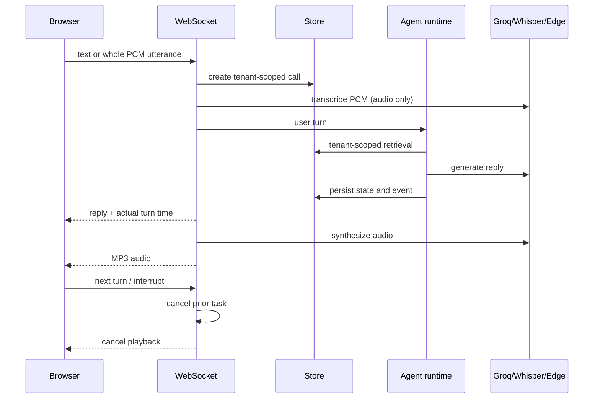

# Architecture

The FastAPI process owns WebSocket sessions. `Engine` handles conservative escalation, tenant-scoped lexical evidence, provider calls, and structured call state. `Store` encapsulates SQLite operations and unique constraints. Each HTTP read/write derives tenant identity from a hashed API key; each WebSocket call is bound to one tenant. Twilio maps the called number to tenant configuration, verifies HMAC signatures, and uses a call ID plus turn number for repeat handling.

No LangGraph was added: the current graph is a small linear state machine with one conditional escalation branch. A framework would add complexity without solving the missing streaming and persistence work. The provider classes are boundaries; only Groq LLM, faster-whisper, Edge TTS, HubSpot, and Google Calendar are implemented, with availability determined by configuration. The old clinic-specific implementation remains archived for audit.
